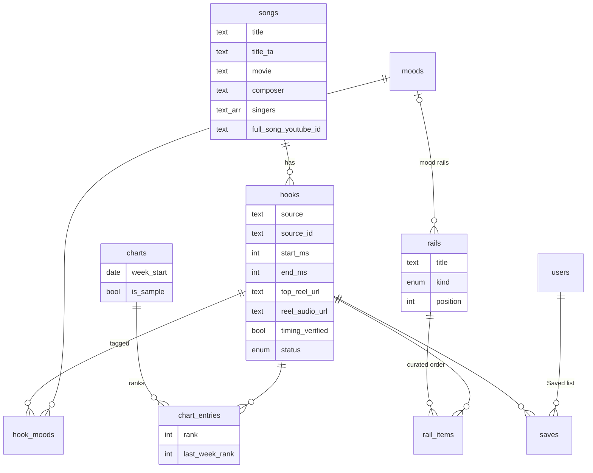

# Hummm

**The best 20 seconds of Tamil songs.** The part everyone hums, the part every Reel uses. Swipe through hooks, save the ones you love, jump to the full song or make your own reel.

> Working name. This is a portfolio project by [Praburaj Kennady](https://praburajkennady.me), a product designer, built in public with AI as a co-builder. It's not a business and isn't affiliated with any label or platform.

## The idea

Most people meet a Tamil song through a 15-second Reel or Short, not the full track. Hummm leans into that: the unit of listening is the **hook**, not the song.

- **Browse** is the home screen: rails of hooks (this week's chart, moods, hand-picked sets) and your Saved list.
- **Listen** is a full-screen swipe feed, one hook at a time, opened from the mini player.
- Every hook has a **Source** sheet (the top Reel using it, and the full song on YouTube) and a **Make a reel** link.

Hummm never hosts, downloads or cuts audio. Every hook plays through the official YouTube or Instagram embed. The database only stores *where* the good part is.

## Build in public

| | |
|---|---|
| Build log | [docs/BUILD_LOG.md](docs/BUILD_LOG.md): what changed and why, entry by entry |
| Decisions | [docs/decisions](docs/decisions): short records of each real choice and its trade-offs |
| API | [docs/API.md](docs/API.md): what the app calls, with examples |

## Stack

Chosen to be cheap (free tier), boring, and small enough to read in one sitting.

- **[Supabase](https://supabase.com)** (Postgres) is the whole backend. The REST API is generated from the schema, so there's no server code to host.
- **Row level security** does authorization: the catalogue is read-only to the public, and your Saved list is visible only to you.
- **Anonymous auth** gives every listener a user id without a sign-up screen.
- **Plain SQL tests** run against a real Postgres in CI on every push.

The backend is about 400 lines of SQL in [`supabase/migrations`](supabase/migrations).

## Data model



- A **hook** is a time range (`start_ms` to `end_ms`, 5 to 90 seconds) inside a YouTube video or an Instagram reel.
- **Trend rank** comes from the latest published weekly **chart**.
- **Rails** are the rows on Browse: `chart` (ranked), `mood` (filled automatically from tags), or `curated` (hand-ordered).
- **Saves** belong to a user. RLS keeps them private.

## API at a glance

| Call | What for |
|---|---|
| `rpc/get_home` | Browse in one request: chart info, every rail with its hooks, your Saved list |
| `rpc/get_feed?p_rail=…` | The swipe feed for a rail, `saved`, or everything (chart first) |
| `rpc/toggle_save` | Save or unsave a hook; returns `true` when it's now saved |
| `hook_cards` | Every published hook with ready-made embed, thumbnail and link URLs |

Details and examples: [docs/API.md](docs/API.md).

## Run it

**Quick test (just Postgres, no Docker):**

```sh
./scripts/test-local.sh            # migrate, seed, run the API tests
PREVIEW=1 ./scripts/test-local.sh  # ...and print what the home screen gets
```

**Full local Supabase (needs Docker and the [Supabase CLI](https://supabase.com/docs/guides/local-development)):**

```sh
supabase start      # applies migrations and seed.sql
supabase status     # shows the API URL and anon key
```

**Deploy:** create a free Supabase project, then `supabase link` and `supabase db push`. Seed with `psql "$DATABASE_URL" -f supabase/seed.sql`.

## Sample data

The seed has 8 real songs (Kaavaalaa, Arabic Kuthu, Rowdy Baby, Vaathi Coming, Why This Kolaveri Di, Naa Ready, Manasilaayo, Golden Sparrow) linked to their official YouTube uploads. Three things are placeholders and are marked as such in the data:

- Hook start and end times are rough guesses (`timing_verified = false`).
- The weekly chart ranks are invented (`is_sample = true`).
- No Instagram reel or audio links yet.

## License

Code is MIT. Songs, videos and artwork belong to their owners and are only ever played through the platforms' own embeds.
